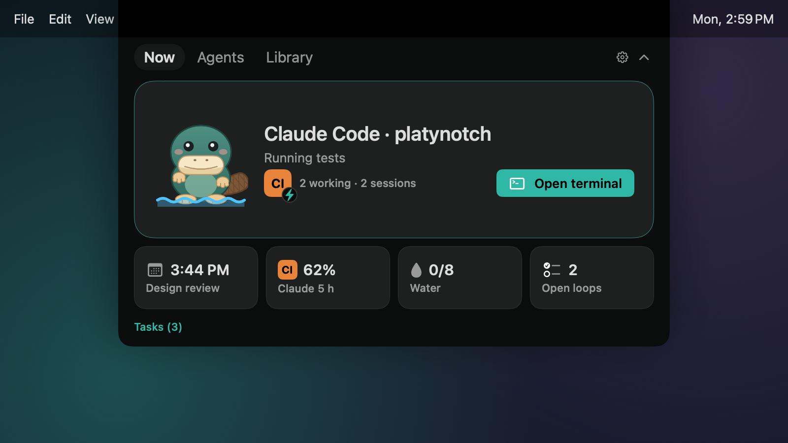

# PlatyNotch

<p align="center">
  
</p>

PlatyNotch is an open-source MacBook notch app. It combines an agent hub
(approve and monitor Claude Code and other coding agents from the notch),
everyday widgets, and local memory that stays on your Mac. Its mascot is Platy
the platypus.

**Status:** early development. Expect breaking changes.

The Go core (`core/`) is the `notch` binary that speaks the socket protocol
described in [docs/PROTOCOL.md](docs/PROTOCOL.md).

## Install

PlatyNotch needs macOS 15 or later. On a MacBook with a notch it sits around
the notch; on displays without one it shows as a pill at the top centre of the
screen, just below the menu bar.

1. Download `PlatyNotch-<version>.dmg` from
   [GitHub Releases](https://github.com/Vaibhaav-Tiwari/PlatyNotch/releases).
   Each release also has a `.sha256` file: `shasum -a 256 PlatyNotch-*.dmg`
   should print the same value.
2. Open the DMG and drag **PlatyNotch** onto **Applications**.

### Opening PlatyNotch the first time

Releases are not yet signed with an Apple Developer ID or notarized, so the
first time you open the app macOS says it can't verify the developer. To open
it anyway, either:

- try to open PlatyNotch once, then go to **System Settings › Privacy &
  Security**, find the message about PlatyNotch and click **Open Anyway**; or
- run `xattr -dr com.apple.quarantine /Applications/PlatyNotch.app` in
  Terminal, then open the app normally.

Open it from `/Applications`, not from the DMG: the app points
`~/Library/Application Support/PlatyNotch/bin/notch` (the command agent
hooks run) at the copy it is running from.

### Updates

When a release is built with an update key, **Check for Updates…** in the
menu bar item installs new versions, and Settings › About has **Automatically
check for updates**. Otherwise download new versions from
[GitHub Releases](https://github.com/Vaibhaav-Tiwari/PlatyNotch/releases) and
replace the app in Applications.

After an update macOS may ask whether PlatyNotch can use its Keychain items
(the API keys you saved in Settings › Memory). Click **Always Allow**.

On-screen capture (memory) uses the Accessibility permission. Because the app
is not Developer ID signed, macOS may not recognise an updated copy as the same
app: if capture stops after an update, untick and re-tick PlatyNotch in
**System Settings › Privacy & Security › Accessibility**.

### Build from source

Needs Xcode (Swift 6), Go (the version in `core/go.mod`) and CMake.

```sh
scripts/build-app.sh            # build/PlatyNotch.app, ad-hoc signed
scripts/make-dmg.sh             # build/PlatyNotch-<version>.dmg
```

`scripts/build-app.sh --sign "Developer ID Application: …"` signs with a
Developer ID and the hardened runtime instead; `scripts/notarize.sh` then
notarizes the DMG.

## Widgets

The open panel's **Today** tab is a column of widget tiles. Turn each widget on or
off, and reorder them, in **Settings › Widgets**. A widget that is off does no work:
no timers, no observers, no network access. The one exception: while the shelf,
clipboard history or Baskets is off, PlatyNotch still deletes their own expired files
once at launch, so the retention below holds.

| Widget | Default | What it does |
| --- | --- | --- |
| Music | on | Now playing with artwork and controls; music bars in the pill. The live visualiser (bars that follow the sound) is a separate toggle, off by default. |
| Meetings | on | The next meeting with a Join button, a countdown in the pill for the last 10 minutes, reminders at 10, 5 and 1 minutes. |
| Focus | on | Focus sessions with a countdown in the pill; during a session agent notices do not peek (approvals still do) and meeting reminders stay quiet. |
| Open loops | on | Open loops from memory (empty while memory is off). |
| Time | on | Timers, a pomodoro, a stopwatch with laps, alarms and world clocks; a system notification backs up each timer and alarm in case the app is quit. |
| Shelf | on | Drag files, images, links or text to the notch to keep them; drag them back out, AirDrop, share or Quick Look them. Finder › Services › Add to PlatyNotch Shelf adds the selected files. With File actions on (a power feature), right-click › Actions converts, zips, unzips, reads text from, removes backgrounds from or renames them. |
| System | on | Battery (plug-in and unplug peeks) and keep-awake. Headphones (AirPods battery) and Downloads (progress and a finished notice) are sub-features, off until you turn them on in its settings. |
| Games | on | Snake, Tetris, 2048, Flappy and Platy Chase (a maze chase with classic arcade rules on our own maze and art) in a Games tab; best scores on the tile. |
| Sites & Shortcuts | on | Pinned websites (http and https only) and pinned Shortcuts, run on a click. |
| Volume & brightness HUD | off | Replaces the system volume, brightness and keyboard-backlight HUD with one under the notch. |
| Clipboard history | off | Keeps what you copy; ⌥⇧V opens a searchable picker. |
| Reminders | off | Reminders due today and overdue, ticked off from the tile, and quick add ("call Priya at 5pm"). |
| Weather | off | The weather for a city you type, from Open-Meteo. |
| Wellbeing | off | Water, stand and 20-20-20 eye-break nudges; they wait during focus, full screen, quiet hours and (when Meetings has calendar access) meetings. |
| File actions (power) | off | No tile: right-click shelf or basket items › Actions to convert images, video and audio, compress video, combine images into a PDF, zip and unzip, copy the text in an image, remove an image's background, or batch rename. |
| Window snapping (power) | off | No tile: ⌃⌥ shortcuts put the focused window into halves, quarters, thirds, two thirds, maximize or center, with an optional gap. Needs Accessibility. |
| Mirror (power) | off | Your camera as a mirror in the tile, only after you click Show Mirror; it stops when you hide it or the panel closes. |
| Mail (power) | off | Apple Mail's unread count and the newest 5 unread senders and subjects, only while Mail is open; click one to open it in Mail. |
| Notes & Tasks (power) | off | A quick-note field and the open tasks (`- [ ]`) of your Obsidian or Markdown vault, ticked from the tile. |
| Baskets (power) | off | No tile: shake the pointer while dragging a file or link and a floating basket appears to drop it into. |

**Platy**, the platypus, sits in the pill beside the agent dots and shows what your
agents are doing: paddling while one works, an amber rim while one waits for you, a
check when one finishes, headphones while music plays, half-closed eyes during focus,
asleep late at night. Turn it off in **Settings › Appearance › Show Platy**. It
follows Reduce Motion.

Manual checks for every widget are in
[scripts/verify-widgets.md](scripts/verify-widgets.md).

### Permissions, network and storage

PlatyNotch asks macOS for a permission only from the button or toggle that needs it,
never at launch. If you update or rebuild the app, macOS may treat it as a new app:
features that rely on a grant (Downloads, the visualiser) then turn themselves off
and show **Turn On Again** instead of prompting by themselves.

| Permission | Asked when | Used by |
| --- | --- | --- |
| Notifications | The first time you make a timer or alarm, or Allow in Settings › Permissions | Backup notifications for timers and alarms |
| Accessibility | You click Allow in Settings › Permissions, Memory, the HUD's settings or Clipboard history's settings | On-screen capture (memory), the HUD's media-key tap, pasting with ↩ from the clipboard picker |
| Calendars | You click Allow Calendar Access on the Meetings or Reminders tile, in Meetings' settings or in Settings › Permissions | Meetings; events made by Reminders' quick add |
| Reminders | You click Allow on the Reminders tile, in its settings or in Settings › Permissions | Reminders |
| Bluetooth | You turn on Headphones in System's settings | AirPods and headphones peek |
| Downloads folder | You click Turn On for Downloads in System's settings | Downloads progress and notices (file names only, never contents) |
| System Audio Recording | You turn on Live visualiser in Music's settings | The visualiser (sound becomes bar heights in memory; nothing is recorded) |
| Automation: your terminal | You click a session to bring its terminal tab to the front | Agent hub |
| Automation: Safari, Chrome or Arc | You click Add current tab in Sites & Shortcuts | Pinning the front tab |
| Automation: Spotify or Music | Only when the bundled now-playing helper can't run, while the Music tile is on screen; or when you tap the favourite button (Music) | Now playing |

Files you put on the shelf or in a basket from Downloads, Desktop, Documents, iCloud
Drive, a network volume or an external drive may make macOS ask for access when the
shelf tile or basket shows them; nothing is checked at launch.

#### Power features (v0.2)

Each is off until you turn it on under Settings › Widgets › Power features, and asks
for its permission only from its own button. While one is off it does no work; the only
exception is the launch cleanup of pinned baskets' expired copies (see Storage).

**File actions** needs no permission and no network: converting, OCR and background
removal run on this Mac (ImageIO, AVFoundation, Vision), and results are new shelf
items in the shelf's folder (kept 7 days unless pinned; Save As… for a copy elsewhere),
never written next to your files. Rename changes your files' names only when you
click Rename, never replacing another file, with one Undo; it never renames your home
folder's own folders (Desktop, Documents, Downloads, Library, …) or anything else in
PlatyNotch's folder (the shelf's own copies and results can be renamed, and stay there). Unzip uses PlatyNotch's own extractor, not ditto: it
unpacks only the files an archive lists, each checked against its declared size and
checksum, and refuses archives that are damaged, encrypted, would write outside their
folder or list more than 50,000 entries. Nothing it unpacks is writable by other users.
Files in Downloads, Desktop
or Documents may make macOS ask for access when an action reads them.

**Window snapping** needs Accessibility, asked only from Allow Accessibility… in its
settings, and no network. Its 15 shortcuts are ⌃⌥ with ← → ↑ ↓ (halves), U I J K
(quarters), D F G (thirds), E T (two thirds), ↩ (maximize) and C (center), held only
while it is on and allowed. It reads the focused window's position and size and sets
them, never its content. A shortcut another app holds is marked "shortcut taken"; one
another PlatyNotch feature holds says which ("used by Baskets").

**Mirror** needs the camera, asked the first time you click Show Mirror in its tile.
The camera runs only while the mirror shows; hiding it, closing the panel, switching
tab, locking the screen or display sleep turns it off, and it never restarts by itself.
Frames go only to the preview on screen: nothing is recorded, saved or sent.

**Mail** needs Automation for Mail, asked only from Allow in the Mail tile. Only while
Mail is open it asks Mail for the unread count and the sender and subject of the
newest 5 unread messages, every 5 minutes and when you open the panel; it never opens
Mail, only reads, and keeps nothing.

**Notes & Tasks** reads the vault you choose with Choose Vault… in its settings
(macOS may ask for access to that folder once) and nothing else. The tile lists open
tasks from notes edited in the last 30 days, soonest due first. Notes writes into your
own vault in two ways only: ticking a task changes that one checkbox (and nothing if the
line changed since it was read), and a quick note you add is appended to the end of
today's daily note, which is made for it only when "Create today's note if missing" is
on. With no vault, quick notes go to PlatyNotch's own `notes.noindex/notes.md`. It
watches the vault for changes and walks it every 5 minutes only while the tile shows.

**Baskets** needs no permission and no network: while dragging a file or link, shake
the pointer and a small basket appears there to drop it into (up to 6 baskets of 50
items; ⌃⌥B brings the next one forward). Shaking while selecting text or drawing never
makes one, and a basket never covers the notch or an approval request. Baskets are
cleared when PlatyNotch quits or Baskets is turned off, deleting only the copies they
made, unless the basket or one of its items is pinned. To keep a copy a basket made
(a dropped image, a file from Photos, an action's result), drag it out to a folder or
use Save As…: anything that points at the copy inside `baskets.noindex` stops working
once the basket is cleared.

**Finder service and links** (no new permission): Finder › Services › Add to
PlatyNotch Shelf is always listed but only shows "Turn on the Shelf" while the shelf is
off. `platynotch://shelf/add?path=…`, `platynotch://timer/start?d=25m` and
`platynotch://clipboard/open` (for Alfred or Raycast) never act on their own: adding
files or starting a timer asks first under the notch, and nothing happens while that
widget is off.

| Permission | Asked when | Used by |
| --- | --- | --- |
| Camera | You click Show Mirror in the Mirror tile | Mirror: the camera runs only while it shows; hiding it, closing the panel, locking the screen or display sleep turns it off. Nothing is recorded |
| Accessibility | You click Allow Accessibility in Window snapping's settings | Window snapping: reads the focused window's position and size and sets them (never its content; nothing stored or sent). Its 15 ⌃⌥ shortcuts are held only while it is on and allowed |
| Automation: Mail | You click Allow in the Mail tile (never from Settings) | Mail: unread count and the newest senders and subjects, read every 5 minutes only while Mail is open. PlatyNotch never opens Mail and keeps nothing |
| Files and Folders (Desktop, Documents, Downloads, iCloud Drive and other cloud folders, network volumes, removable drives) | A file there is first opened at your request: one you put on the shelf or in a basket, a File action you run on it, or a vault you choose with Choose Vault… in Notes & Tasks' settings (once; again after an update with Turn On Again…) | Shelf and Baskets (showing and dragging out the files you added), File actions (reading the files you run an action on), Notes & Tasks (open tasks from notes edited in the last 30 days, ticking a task's checkbox, quick notes appended to today's daily note) |

Network: nothing is sent anywhere unless you turn on something that is network by
nature.

| Feature | Talks to | What is sent |
| --- | --- | --- |
| Weather | `geocoding-api.open-meteo.com`, `api.open-meteo.com` (https) | The city you type (when you press Search); the chosen place's coordinates rounded to about 1 km, every 30 minutes |
| Pinned-site icons | Each pinned https site's own origin | A request for its icon, after you pin it (no cookies; plain http sites get a letter icon) |
| Update checks | `vaibhaav-tiwari.github.io` (only in builds with an update key) | A request for the release feed |
| Memory providers | The Ollama or OpenAI-compatible endpoint you configure | See [Memory and privacy](#memory-and-privacy) |

Storage stays on your Mac. The folders below are in
`~/Library/Application Support/PlatyNotch/`, readable only by you (`0700`), and
excluded from Time Machine and Spotlight (`.noindex`). Folders made by earlier builds
(`shelf`, `clipboard`, `favicons`) are renamed at the next launch.

| What | Where | Kept |
| --- | --- | --- |
| Shelf | `shelf.noindex/`: the list, copies of dropped images and of files from apps like Photos or Mail, dropped text | Copies and text are deleted 7 days after you added them, unless pinned. Files you drop from disk stay where they are and are never deleted. If the shelf's list is ever damaged, it is set aside with the copies it may have listed and nothing is deleted; Settings › Widgets › Shelf then shows how many were kept, with Delete Kept Copies. |
| Baskets | `baskets.noindex/<basket>/`: the same as the shelf, one folder per basket | Cleared at quit or when Baskets is turned off, unless the basket or an item in it is pinned; copies in a pinned basket are deleted 7 days after you added them unless pinned (while Baskets is off, once at launch). Your own files are never deleted. |
| Quick notes without a vault | `notes.noindex/notes.md`: quick notes added while Notes & Tasks has no vault | Until you delete them. Notes added with a vault go into that vault's daily note instead. |
| Clipboard history | `clipboard.noindex/`: the history and copied images | 1, 7 (default) or 30 days, and at most 50–500 items (200 by default); pinned items stay. Never saved: anything copied in a password manager or marked as a password by the app that copied it, and text that looks like an API key, token, private key or card number. A password copied from anywhere else (a note, a chat) can be saved; Clear History (or Clear All, Including Pinned, for a pinned one) deletes it. |
| Pinned-site icons | `favicons.noindex/` | 30 days, then fetched again |
| Settings and small state | The app's preferences (`dev.platynotch.app`): widget order, timers, alarms and world clocks, the focus session, pinned sites and Shortcuts, best game scores, the weather city, wellbeing settings and the water log | Until you change them; the water log keeps 14 days |

Calendar events, reminders and what is playing are read when shown and not stored.

## Memory and privacy

Memory is **off by default**. Turn it on in **Settings › Memory** (setting
`"memory": {"enabled": true}` in
`~/Library/Application Support/PlatyNotch/config.json` also works).

- **Local only.** Captured screen text is stored in
  `~/Library/Application Support/PlatyNotch/memory.db`, a SQLite file (and its
  `-wal`/`-shm` sidecars) readable only by you (mode `0600`). The database is
  not encrypted by PlatyNotch; turn on **FileVault** to protect it at rest.
- **Nothing leaves your Mac unless you configure a provider.** The default
  embedder and extractor are `none` (keyword search only). If you set one,
  text goes only to that endpoint: `ollama` (local by default) or any
  OpenAI-compatible API. Plain `http://` is refused for anything but
  localhost.
- **Redacted before storage:** private key blocks, JWTs, `sk-` API keys, AWS
  access key ids, GitHub tokens (`ghp_`/`gho_`/`ghu_`/`ghs_`/`ghr_`,
  `github_pat_`), Slack tokens (`xox?-`), Google API keys (`AIza…`) and
  Luhn-valid card numbers. Window titles are redacted too, and URLs are kept
  without their query string, fragment or credentials. Redaction is
  pattern-based, so it cannot catch every secret.
- **Never captured:** password managers and Keychain Access by default; add
  bundle ids to `memory.exclude_apps` to skip more apps.
- **Retention:** captures older than `memory.retention_days` (90 by default)
  are deleted and overwritten on disk daily.

### Use your memory from AI apps (MCP)

`notch mcp` is a local stdio MCP server that lets AI apps search your memory
and open loops, and read your memory graph. Register it with:

```sh
notch mcp install claude-desktop   # or: claude-code, cursor
notch mcp uninstall claude-desktop
```

The server reads `memory.db` on your Mac, but the results go to the AI app
that asked, and that app may send them to its own model provider. Connect
only apps you trust with your screen history. `memory_graph` also shares the
sites you visited and which windows you used one after another.

### On-screen capture (Mac app)

With memory on and Accessibility granted, the app reads the frontmost window's
text through the Accessibility API and sends it to the local core. It never
captures:

- password managers and Keychain Access (always, even if you edit
  `memory.exclude_apps`), apps listed in `memory.exclude_apps`, PlatyNotch
  itself, the login window, or System Settings' password panes;
- secure text fields, or anything while secure input is on, the screen is
  locked, or your session is not on the console;
- private or incognito browser windows. Detection is **heuristic**: it looks
  for "Incognito", "InPrivate", "Private Browsing", "Private Window" or
  "— Private" in the window title and accessibility description, and skips
  browser windows whose title cannot be read. Safari does not always mark a
  Private window, so add Safari to `memory.exclude_apps` (or pause capture)
  if that matters to you.

"Pause capture for 1 hour" is in the menu bar item's menu and in the Memory
tab.

**Graph.** The Memory tab's Graph view draws the apps, threads (pages,
documents, conversations), sites and open loops from the last 24 hours, 7 days
or 30 days, linked by where you saw them and what was active one after another. It is
built on your Mac from `memory.db`, with no AI involved, and AI apps can read
the same graph through the `memory_graph` MCP tool. It covers at most the last
90 days and is computed when you open it; precomputed links for longer
histories are a follow-up.

## License

Apache-2.0. See [LICENSE](LICENSE) and [NOTICE](NOTICE).
